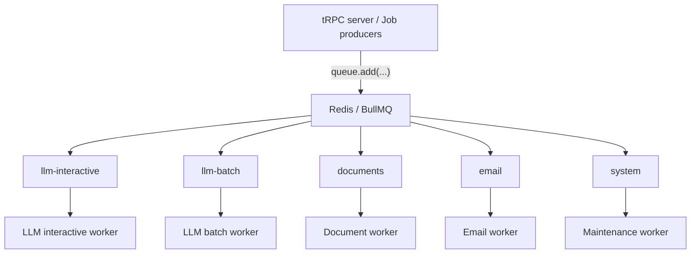
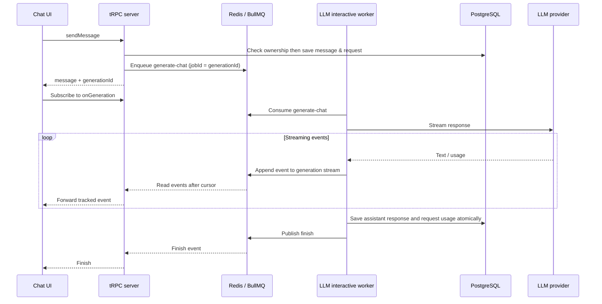
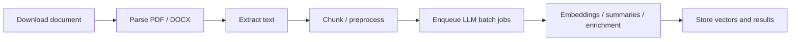

# Background job architecture

The tRPC server and other producers add jobs to BullMQ queues in Redis. Each queue has a dedicated worker for its
workload.

## Queues and workers



| Queue             | Jobs                                                | Why separate                                    |
|-------------------|-----------------------------------------------------|-------------------------------------------------|
| `llm-interactive` | Chat generation, title generation, summaries        | User is waiting; needs priority and low latency |
| `llm-batch`       | Document summaries, embeddings, enrichment          | Can take longer; shouldn't block chat           |
| `documents`       | PDF/DOCX parsing, chunking, preprocessing           | CPU and memory heavy                            |
| `email`           | Invitations, verification, notifications            | External provider with retries and rate limits  |
| `system`          | Cleanup, expired invitations, scheduled maintenance | Low priority background work                    |

Chat response generation is implemented in `llm-interactive`. The other task-specific handlers in the table remain
planned.

## Chat response generation



- The API checks user and organization ownership before subscribing. It no longer calls the provider or stores streaming
  events in memory.
- Redis Streams retain events for one hour after the last event, supporting late subscriptions and reconnects using
  Redis stream IDs.
- The worker validates conversation ownership again, calls the configured provider, and saves the final response and
  usage before publishing completion.
- Automatic provider retries are disabled. Interrupted generations fail instead of replaying partial output or charging
  for duplicate generation.
- Provider streaming has a ten-minute timeout. Disconnecting the browser closes its Redis reader; generation continues
  and saves the response.
- Expired streams tell the client to reload the conversation to see the persisted response.

The server and worker must use the same Redis instance and database. Provider API keys must be available to the worker.
Rebuild both containers after dependency or code changes:

```sh
docker compose up -d --build --no-deps server worker
```

Run integration tests from the repository root with local Redis running:

```sh
pnpm --filter @enterprise/worker test
```

Tests mock database and provider calls and use only temporary UUID-scoped Redis keys. Set `REDIS_TEST_URL` to use a
separate test Redis instance.

## Document processing pipeline

The planned pipeline separates parsing from LLM work:



Parsing and preprocessing belong to `documents`. Embeddings, document summaries, and enrichment belong to `llm-batch`.

## Code layout

| Location                                         | Responsibility                                                                       |
|--------------------------------------------------|--------------------------------------------------------------------------------------|
| [index.ts](index.ts)                             | Load environment configuration, start all five workers, and handle graceful shutdown |
| [src/queue.constants.ts](src/queue.constants.ts) | Define queue names shared by producers and workers                                   |
| `src/queues/*.queue.ts`                          | Export queue instances used to enqueue jobs                                          |
| `src/workers/*.worker.ts`                        | Define each worker and its processor                                                 |
| [src/redis.ts](src/redis.ts)                     | Configure the Redis connection                                                       |

## Concurrency and resource isolation

Separate queues allow independent concurrency and rate limits. Queue names alone do not enforce priority or resource
isolation.

All five workers currently run in the same process. CPU-heavy document work should use sandboxed processors or separate
processes to protect chat latency.
