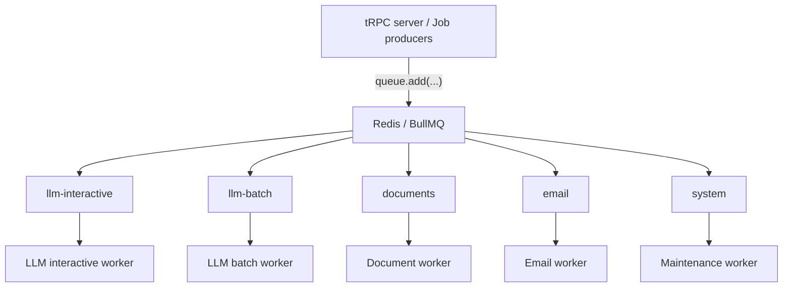

# Background job architecture

The tRPC server and other producers add jobs to BullMQ queues in Redis. Each queue has a dedicated worker for its workload.

## Queues and workers

| Queue | Jobs | Why separate |
| --- | --- | --- |
| `llm-interactive` | Chat generation, title generation, summaries | User is waiting; needs priority and low latency |
| `llm-batch` | Document summaries, embeddings, enrichment | Can take longer; shouldn't block chat |
| `documents` | PDF/DOCX parsing, chunking, preprocessing | CPU and memory heavy |
| `email` | Invitations, verification, notifications | External provider with retries and rate limits |
| `system` | Cleanup, expired invitations, scheduled maintenance | Low priority background work |

The table describes intended responsibilities. Task-specific job handlers still need implementation.

## Document processing pipeline

The planned pipeline separates parsing from LLM work:

Parsing and preprocessing belong to `documents`. Embeddings, document summaries, and enrichment belong to `llm-batch`.

## Code layout

| Location | Responsibility |
| --- | --- |
| [index.ts](index.ts) | Load environment configuration, start all five workers, and handle graceful shutdown |
| [src/queue.constants.ts](src/queue.constants.ts) | Define queue names shared by producers and workers |
| `src/queues/*.queue.ts` | Export queue instances used to enqueue jobs |
| `src/workers/*.worker.ts` | Define each worker and its processor |
| [src/redis.ts](src/redis.ts) | Configure the Redis connection |

## Concurrency and resource isolation

Separate queues allow independent concurrency and rate limits. Queue names alone do not enforce priority or resource isolation.

All five workers currently run in the same process. CPU-heavy document work should use sandboxed processors or separate processes to protect chat latency.
